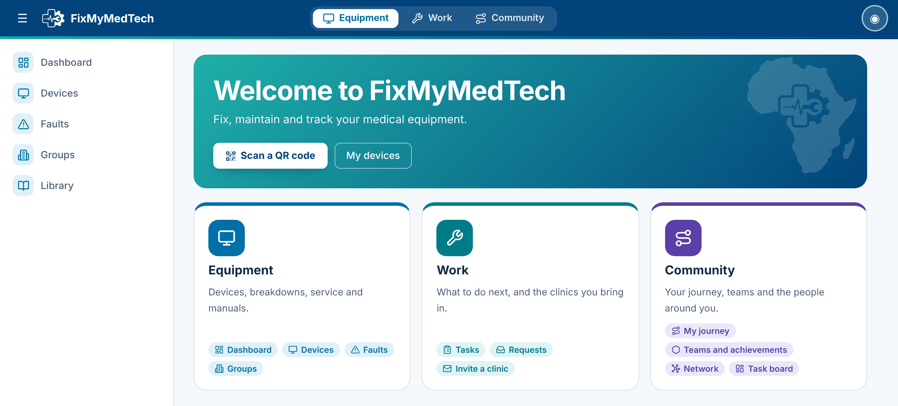
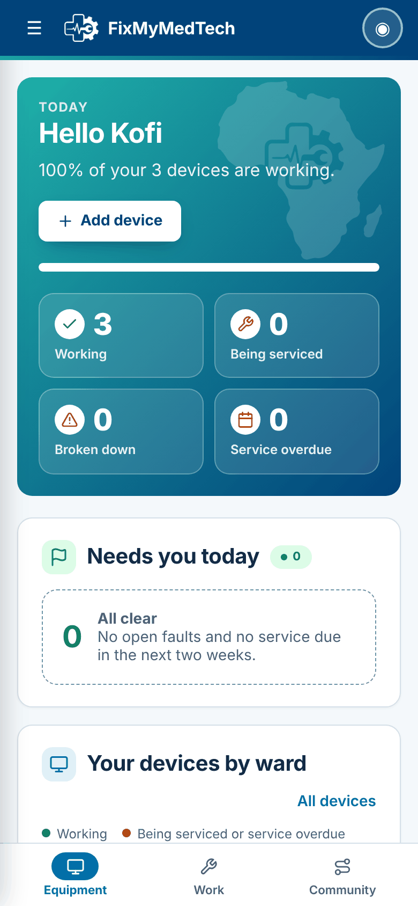
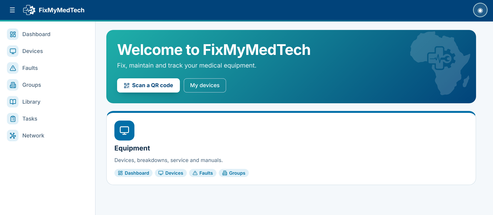

# Cómo está organizada la aplicación

**En la aplicación:** las pestañas de arriba (en el teléfono, abajo) y el logo, que abre **Inicio**.

**Para quién es:** todos, antes del primer uso.

FixMyMedTech tiene tres partes, llamadas **mundos**. Cada una tiene su color y su propio menú.

| Mundo | Color | Para qué sirve | Menú |
| --- | --- | --- | --- |
| Equipamiento | Azul | Los dispositivos de la clínica: lista, fallas, mantenimiento, manuales | **Panel**, **Dispositivos**, **Fallas**, **Grupos**, **Biblioteca** |
| Trabajo | Turquesa | El día del ingeniero: qué hacer ahora, solicitudes de reparación, clínicas que traer | **Tareas**, **Solicitudes**, **Invitar a una clínica**, **Anfitrión de charlas** (solo anfitriones) |
| Comunidad | Morado | Tu recorrido, los equipos, las personas, los pequeños trabajos de la comunidad | **Mi recorrido**, **Equipos y logros**, **Red**, **Tablero de tareas**, **Por validar** y **Admin comunidad** (solo miembros de un equipo) |

{ .shot loading=lazy }

## Cómo moverte

- **En un ordenador**, los mundos son pestañas en la barra de arriba. El menú de la izquierda lista solo las páginas del mundo en el que estás.
- **En el teléfono**, los mundos son pestañas en la parte de abajo de la pantalla. Toca **☰** (arriba a la izquierda) para abrir el menú del mundo actual.
- **El logo** abre **Inicio**: una puerta por mundo, con sus páginas principales.
- **El idioma** (EN, ES, FR) y el tema claro u oscuro están al final del menú.
- **Tu perfil** y **Cerrar sesión** están detrás del avatar redondo de arriba a la derecha.

<figure markdown>
{ .phone loading=lazy }
<figcaption>En el teléfono: los mundos están abajo.</figcaption>
</figure>

## Quién ve qué

Solo ves lo que puedes usar. Se abre más a medida que avanzas.

| Quién | Qué ves |
| --- | --- |
| **Ingeniero nuevo** (Visitante: pasos de bienvenida sin terminar) | Solo **Primeros pasos** y **Biblioteca**. Sin pestañas. Cualquier otra página te devuelve a **Primeros pasos**. |
| **Ingeniero con los pasos de bienvenida hechos** (Colaborador) | Los tres mundos. **Primeros pasos** desaparece; **Invitar a una clínica** es tu siguiente paso. |
| **Cuenta de clínica y personal de la clínica** (administrador, enfermero, médico, técnico añadido por la clínica) | Un solo menú, sin pestañas: **Panel**, **Dispositivos**, **Fallas**, **Grupos**, **Biblioteca**, **Tareas**, **Red**. |

Algunas personas ven unas entradas más:

- **Anfitrión de charlas**: miembros y líderes de los Constructores de comunidad y de los Conectores de clínicas.
- **Por validar** y **Admin comunidad**: miembros y líderes de un equipo.

{ .shot loading=lazy }

## De Visitante a Colaborador y a Miembro

Tu estado aparece en tu perfil, como **Estado de la cuenta:**.

1. **Visitante.** Te uniste en **Únete a la comunidad**. La aplicación dice: *"Completa tus pasos de bienvenida para ser colaborador."*
2. **Colaborador.** Terminaste los tres **pasos de bienvenida** (la página **Primeros pasos** los llama *misiones de bienvenida*):
    - **Completa tu perfil**: tu país, tu ciudad y unas palabras sobre por qué elegiste la ingeniería biomédica.
    - **Añade una foto**: una foto clara de tu cara.
    - **Asiste a una charla de la comunidad**: una videollamada corta. El anfitrión marca este paso después de la llamada.

    Cuando termina el último ves *"¡Bienvenido/a a la comunidad!"* y se abren los tres mundos. Ya puedes invitar clínicas y registrar dispositivos para cada clínica que te nombre uno de sus ingenieros responsables.
3. **Miembro de un equipo.** Hay tres equipos: **Comunicador**, **Constructor de comunidad** y **Conector de clínicas**. Un Constructor de comunidad te hace **Candidato**; después el **Líder** del equipo te hace **Miembro**. Mira [Cómo funciona la comunidad](community-guide.md).

!!! note "Personal de la clínica"
    Las personas añadidas por su clínica, y las cuentas de clínica, no necesitan los pasos de bienvenida: las páginas de su clínica están abiertas desde el principio. Aun así pueden hacer los pasos para ser colaboradores de la comunidad.

## Siguiente

- [Trabajo en una clínica](start-clinic.md)
- [Soy ingeniero](start-engineer.md)
- [Soy líder o anfitrión en la comunidad](start-lead.md)
