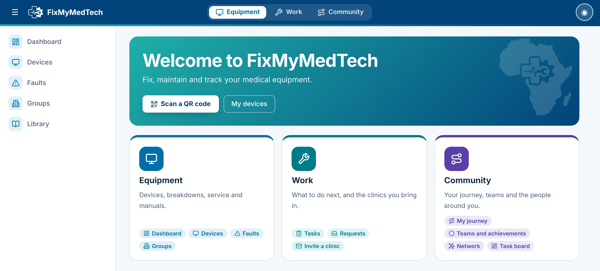
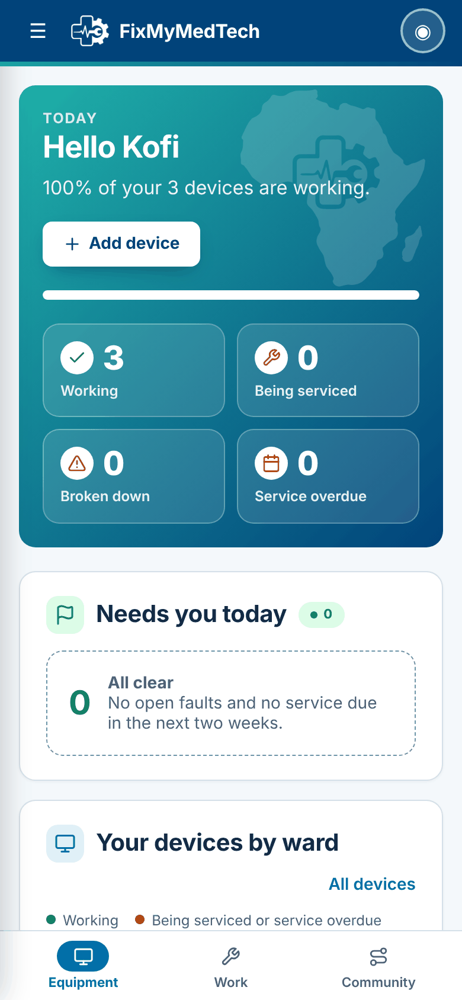
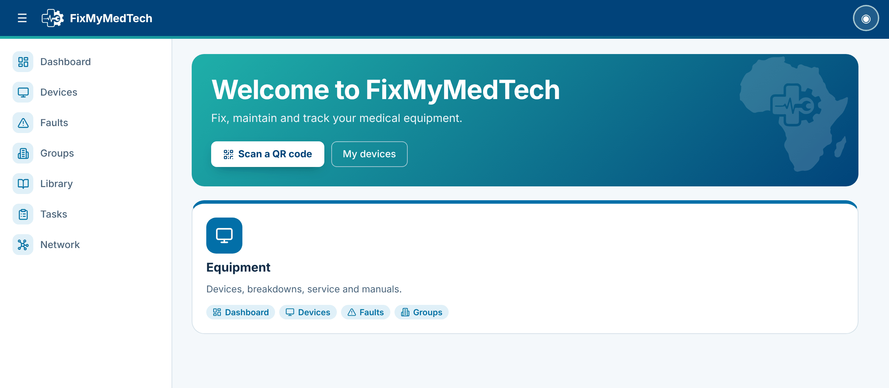

# Comment l'application est organisée

**Dans l'application :** les onglets en haut (sur téléphone, en bas), et le logo, qui ouvre l'**Accueil**.

**Pour qui :** tout le monde, avant la première utilisation.

FixMyMedTech a trois parties, appelées **mondes**. Chacune a sa couleur et son propre menu.

| Monde | Couleur | À quoi il sert | Menu |
| --- | --- | --- | --- |
| Équipements | Bleu | Les appareils de la clinique : liste, pannes, entretien, manuels | **Tableau de bord**, **Appareils**, **Pannes**, **Groupes**, **Bibliothèque** |
| Travail | Turquoise | La journée de l'ingénieur : quoi faire ensuite, demandes de réparation, cliniques à faire venir | **Tâches**, **Demandes**, **Inviter une clinique**, **Animation des rencontres** (animateurs seulement) |
| Communauté | Violet | Votre parcours, les équipes, les personnes, les petits travaux de la communauté | **Mon parcours**, **Équipes et réussites**, **Réseau**, **Tableau des tâches**, **À valider** et **Admin communauté** (membres d'équipe seulement) |

{ .shot loading=lazy }

## Se déplacer

- **Sur ordinateur**, les mondes sont des onglets dans la barre du haut. Le menu de gauche ne liste que les pages du monde où vous êtes.
- **Sur téléphone**, les mondes sont des onglets en bas de l'écran. Touchez **☰** (en haut à gauche) pour ouvrir le menu du monde actuel.
- **Le logo** ouvre l'**Accueil** : une porte par monde, avec ses pages principales.
- **La langue** (EN, ES, FR) et le thème clair ou sombre sont en bas du menu.
- **Votre profil** et **Déconnexion** sont derrière l'avatar rond en haut à droite.

<figure markdown>
{ .phone loading=lazy }
<figcaption>Sur téléphone : les mondes sont en bas.</figcaption>
</figure>

## Qui voit quoi

Vous ne voyez que ce que vous pouvez utiliser. Le reste s'ouvre au fur et à mesure.

| Qui | Ce que vous voyez |
| --- | --- |
| **Nouvel ingénieur** (Visiteur : étapes d'accueil pas terminées) | Seulement **Premiers pas** et **Bibliothèque**. Pas d'onglets. Toutes les autres pages vous ramènent à **Premiers pas**. |
| **Ingénieur dont les étapes d'accueil sont terminées** (Contributeur) | Les trois mondes. **Premiers pas** disparaît ; **Inviter une clinique** est votre prochaine étape. |
| **Compte clinique et personnel de clinique** (administrateur, infirmier, médecin, technicien ajouté par la clinique) | Un seul menu, sans onglets : **Tableau de bord**, **Appareils**, **Pannes**, **Groupes**, **Bibliothèque**, **Tâches**, **Réseau**. |

Certaines personnes voient quelques entrées de plus :

- **Animation des rencontres** : les membres et responsables des Bâtisseurs de communauté et des Connecteurs de cliniques.
- **À valider** et **Admin communauté** : les membres et responsables d'une équipe.

{ .shot loading=lazy }

## De Visiteur à Contributeur, puis Membre

Votre statut apparaît sur votre profil, sous **Statut du compte :**.

1. **Visiteur.** Vous vous êtes inscrit avec **Rejoindre la communauté**. L'application dit : *« Terminez vos étapes d'accueil pour devenir contributeur. »*
2. **Contributeur.** Vous avez terminé les trois **étapes d'accueil** (la page **Premiers pas** les appelle *quêtes de bienvenue*) :
    - **Complétez votre profil** : votre pays, votre ville et quelques mots sur votre choix du génie biomédical.
    - **Ajoutez une photo** : une photo nette de votre visage.
    - **Assistez à une rencontre de la communauté** : un court appel vidéo. L'animateur coche cette étape après l'appel.

    Quand la dernière est faite, vous voyez *« Bienvenue dans la communauté ! »* et les trois mondes s'ouvrent. Vous pouvez inviter des cliniques et enregistrer les appareils de chaque clinique qui vous nomme ingénieur responsable.
3. **Membre d'une équipe.** Il y a trois équipes : les **Communicants**, les **Bâtisseurs de communauté** et les **Connecteurs de cliniques**. Un Bâtisseur de communauté fait de vous un **Candidat** ; le **Responsable** de l'équipe fait ensuite de vous un **Membre**. Voir [Comment fonctionne la communauté](community-guide.md) (en anglais).

!!! note "Personnel de clinique"
    Les personnes ajoutées par leur clinique, et les comptes clinique, n'ont pas besoin des étapes d'accueil : les pages de leur clinique sont ouvertes tout de suite. Ils peuvent quand même faire les étapes pour devenir contributeurs de la communauté.

## Ensuite

- [Je travaille dans une clinique](start-clinic.md)
- [Je suis ingénieur](start-engineer.md)
- [J'anime ou je dirige dans la communauté](start-lead.md)
