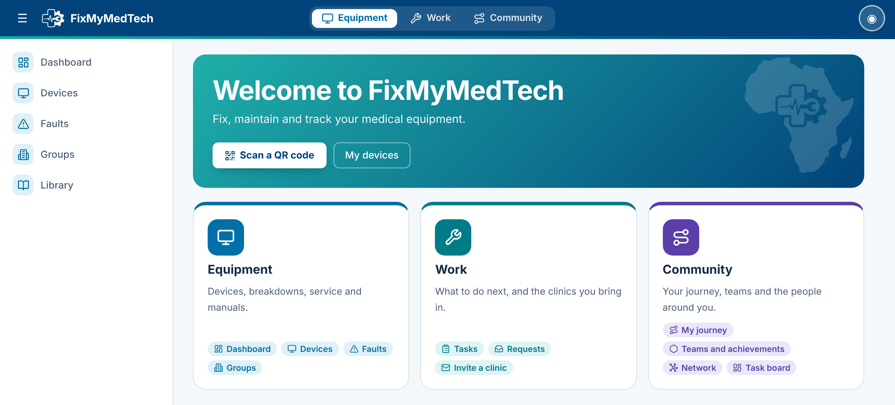
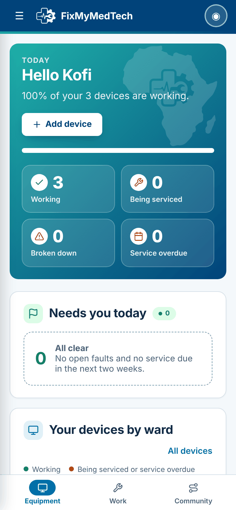
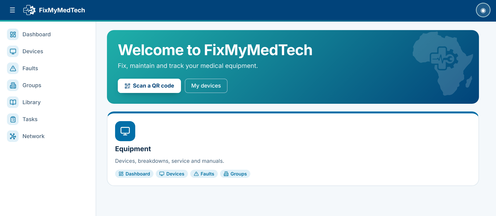

# How the app is organised

**In the app:** the tabs at the top (on a phone, at the bottom), and the logo, which opens **Home**.

**Who this is for:** everyone, before the first use.

FixMyMedTech has three parts, called **worlds**. Each has its colour and its own menu.

| World | Colour | What it is for | Menu |
| --- | --- | --- | --- |
| Equipment | Blue | The clinic's devices: list, faults, service, manuals | **Dashboard**, **Devices**, **Faults**, **Groups**, **Library** |
| Work | Teal | The engineer's day: what to do next, repair requests, clinics to bring in | **Tasks**, **Requests**, **Invite a clinic**, **Talk host** (hosts only) |
| Community | Purple | Your journey, teams, people, small community jobs | **My journey**, **Teams and achievements**, **Network**, **Task board**, **To validate** and **Community admin** (team members only) |

{ .shot loading=lazy }

## Moving around

- **On a computer**, the worlds are tabs in the top bar. The menu on the left lists only the pages of the world you are in.
- **On a phone**, the worlds are tabs at the bottom of the screen. Tap **☰** (top left) to open the menu of the current world.
- **The logo** opens **Home**: one door per world, with its main pages.
- **The language** (EN, ES, FR) and the light or dark theme are at the bottom of the menu.
- **Your profile** and **Logout** are behind the round avatar at the top right.

<figure markdown>
{ .phone loading=lazy }
<figcaption>On a phone: the worlds are at the bottom.</figcaption>
</figure>

## Who sees what

You only see what you can use. More opens as you go.

| Who | What you see |
| --- | --- |
| **New engineer** (Visitor: welcome steps not done) | Only **Getting started** and **Library**. No tabs. Every other page brings you back to **Getting started**. |
| **Engineer whose welcome steps are done** (Contributor) | All three worlds. **Getting started** is gone; **Invite a clinic** is your next step. |
| **Clinic account and clinic staff** (administrator, nurse, doctor, technician added by the clinic) | One menu, no tabs: **Dashboard**, **Devices**, **Faults**, **Groups**, **Library**, **Tasks**, **Network**. |

Some people see a few more entries:

- **Talk host**: members and leads of the Community Builders and of the Clinics Connectors.
- **To validate** and **Community admin**: members and leads of a team.

{ .shot loading=lazy }

## From Visitor to Contributor to Member

Your status shows on your profile, as **Account status:**.

1. **Visitor.** You joined at **Join the community**. The app says: *"Finish your welcome steps to become a contributor."*
2. **Contributor.** You finished the three **welcome steps** (the **Getting started** page calls them *welcome quests*):
    - **Complete your profile**: your country, your city and a few words on why you chose biomedical engineering.
    - **Add a photo**: a clear photo of your face.
    - **Attend a community talk**: a short video call. The host ticks this step after the call.

    When the last one is done you see *"Welcome to the community!"* and the three worlds open. You can now invite clinics, and register devices for every clinic that names you one of its responsible engineers.
3. **Member of a team.** There are three teams: **Communicators**, **Community Builders** and **Clinics Connectors**. A Community Builder makes you a **Candidate**; the team's **Lead** then makes you a **Member**. See [How the community works](community-guide.md).

!!! note "Clinic staff"
    People added by their clinic, and clinic accounts, do not need the welcome steps: their clinic's pages are open at once. They can still do the steps to become contributors of the community.

## Next

- [I work in a clinic](start-clinic.md)
- [I am an engineer](start-engineer.md)
- [I lead or host in the community](start-lead.md)
