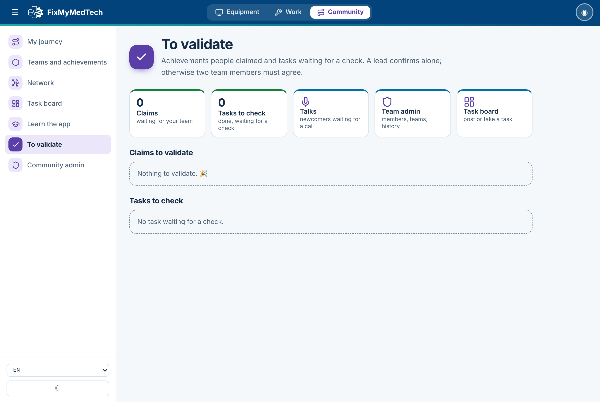

# Por validar

**En la aplicación:** Comunidad → **Por validar**.

**Para quién es:** miembros y líderes de un equipo (Comunicadores, Constructores de comunidad, Conectores de clínicas).

**Qué necesitas antes:** eres **Miembro** o **Líder** de un equipo y has estado activo en la plataforma en los últimos seis meses.

**Por validar** reúne el trabajo que espera una revisión: los logros que la gente ha reclamado y las tareas marcadas como hechas en el tablero de tareas.

## Pasos

### Valida un reclamo

1. Abre **Por validar**. **Reclamos por validar** lista los reclamos de los logros de tu equipo, con la nota y la foto de prueba.
2. Lee qué pasó. Después:
    - **Confirmar** (líderes): el reclamo queda confirmado de inmediato.
    - **Estoy de acuerdo** (miembros): tu voto cuenta como uno de dos. Un segundo miembro también debe estar de acuerdo.
    - **Pedir más**, con una nota corta: el reclamo vuelve a su autor.
    - **Rechazar**: el reclamo se cierra.

Nunca validas tu propio reclamo.

### Revisa una tarea

1. **Tareas por revisar** lista las tareas marcadas como hechas.
2. Mira la nota o el enlace. Toca **Está bien** (los puntos van a quien la hizo) o **Devolver** (la tarea vuelve a esa persona).

La revisa el autor de la tarea o un líder de equipo; quien hizo la tarea nunca la revisa.

Los atajos de arriba llevan a **Charlas** (para los anfitriones de charlas), **Admin. de equipos** y **Tablero**.

{ .shot loading=lazy }

## Qué pasa después

Un reclamo confirmado se suma al contador del logro de la persona, y puede darle una estrella nueva. Lo ve en **Mi recorrido**.

## Si algo sale mal

- **"Únete a un equipo para validar sus logros."** Todavía no eres miembro de un equipo. Pide a un Constructor de comunidad que te haga Candidato y después al líder del equipo.
- **No veo un reclamo que esperaba.** Solo ves los reclamos de los logros de tu propio equipo, y nunca los tuyos.
- **No veo Por validar en el menú.** Los candidatos y las cuentas en pausa (sin actividad en seis meses) no lo tienen. Cualquier acción en la aplicación reactiva tus poderes de equipo.
